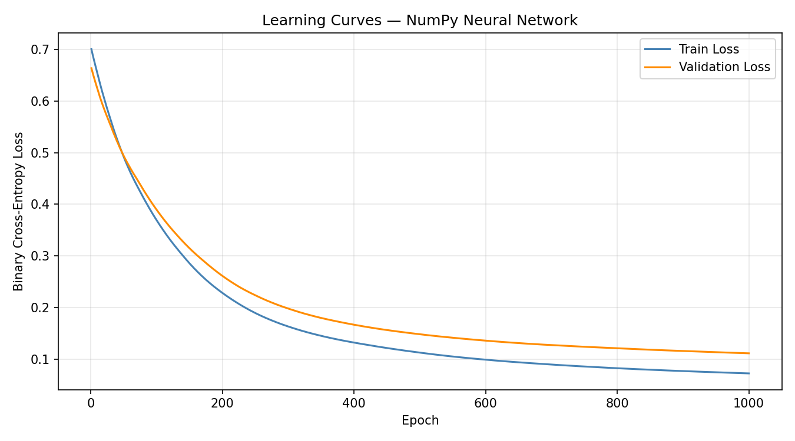
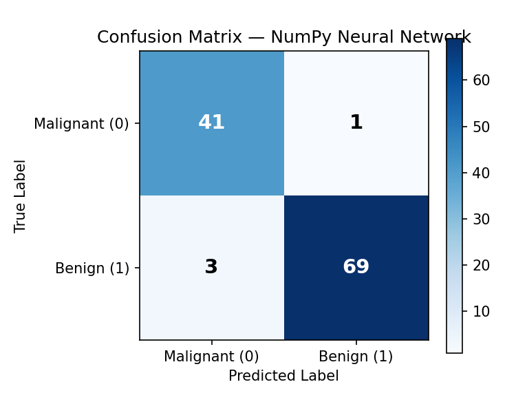

# Neural Network from Scratch

[](https://github.com/patrashriyansu/neural-network-from-scratch/actions/workflows/ci.yml)


> **A complete implementation of a neural network built twice — manually with NumPy and equivalently with PyTorch — applied to real-world binary classification.**

---

## Overview

This project demonstrates a deep understanding of neural network internals by implementing every component from first principles:

- **NumPy implementation:** Forward propagation, backpropagation, and gradient descent coded entirely by hand with no autograd — only matrix operations.
- **PyTorch implementation:** An equivalent model using PyTorch's `nn.Module`, with trained weights transferred from the NumPy model to verify numerical agreement.
- **Validation:** Numerical gradient checking confirms the correctness of the hand-coded backpropagation. The two frameworks are compared against each other on identical inputs.

**Dataset:** Breast Cancer Wisconsin Diagnostic (scikit-learn) — a standard benchmark for binary classification.

---

## Problem Statement

**Task:** Binary classification — predict whether a tumor is **malignant (1)** or **benign (0)**.

Each sample is described by 30 real-valued features computed from digitized images of fine needle aspirate (FNA) of breast masses. These features describe the characteristics of the cell nuclei present in the image (radius, texture, perimeter, area, smoothness, etc.).

Accurate early detection of malignant tumors is critical in oncology — this makes the dataset a meaningful and well-understood benchmark.

---

## Dataset

| Property           | Value                                               |
|--------------------|-----------------------------------------------------|
| Source             | `sklearn.datasets.load_breast_cancer()`             |
| Total Samples      | 569                                                 |
| Features           | 30 real-valued (all numeric, no missing values)     |
| Classes            | 2 (Malignant = 1, Benign = 0)                       |
| Class distribution | ~37% malignant, ~63% benign                         |
| Train / Test Split | 80% / 20% stratified split (455 train, 114 test)    |
| Preprocessing      | `StandardScaler` fit on train set only, applied to both |

**Stratified splitting** ensures that the class distribution is preserved in both train and test sets, preventing accidental data imbalance.

**Feature standardization** (zero mean, unit variance) is essential: unnormalized features with very different scales would cause the gradient descent optimizer to perform poorly.

---

## Network Architecture

```
Input(30) --> Dense(30x16) --> ReLU --> Dense(16x8) --> ReLU --> Dense(8x1) --> Sigmoid --> Prediction
```

| Layer    | Type  | Input | Output | Activation | Weight Shape | Bias Shape |
|----------|-------|-------|--------|------------|--------------|------------|
| Layer 1  | Dense | 30    | 16     | ReLU       | (30, 16)     | (1, 16)    |
| Layer 2  | Dense | 16    | 8      | ReLU       | (16, 8)      | (1, 8)     |
| Layer 3  | Dense | 8     | 1      | Sigmoid    | (8, 1)       | (1, 1)     |

**Total trainable parameters:**
- W1: 30×16 = 480, b1: 16 → **496**
- W2: 16×8 = 128, b2: 8 → **136**
- W3: 8×1 = 8, b3: 1 → **9**
- **Total: 641 parameters**

**Training configuration:**

| Hyperparameter | Value                          |
|----------------|--------------------------------|
| Loss function  | Binary Cross-Entropy           |
| Optimizer      | Full-batch Gradient Descent    |
| Learning Rate  | 0.01                           |
| Epochs         | 1000                           |
| Initialization | He initialization              |
| Random Seed    | 42                             |

For the full mathematical treatment of every operation, see [MATH.md](MATH.md).

---

## Technologies Used

| Library        | Purpose                                           | Version |
|----------------|---------------------------------------------------|---------|
| Python         | Core language                                     | 3.x     |
| NumPy          | Manual neural network implementation              | 2.x     |
| PyTorch        | Framework-based equivalent implementation         | 2.x     |
| scikit-learn   | Dataset loading, preprocessing, metrics           | 1.x     |
| Matplotlib     | Visualizations (loss curves, confusion matrix)    | 3.x     |
| pytest         | Unit and integration testing                      | 9.x     |
| Jupyter        | Interactive notebooks (Google Colab)              | —       |

---

## NumPy Implementation

Located in `numpy_implementation/`.

Every component is implemented **from scratch** using only NumPy matrix operations — no automatic differentiation:

### What was manually implemented:

1. **Weight Initialization** — He initialization (`W ~ N(0, sqrt(2/fan_in))`) for stable gradient flow through ReLU layers.

2. **Forward Propagation** — Matrix multiplications, bias additions, and activation functions applied layer by layer, with intermediate values (`Z1, A1, Z2, A2, Z3`) cached for use in backpropagation.

3. **Loss Computation** — Numerically stable Binary Cross-Entropy with prediction clipping at `[1e-15, 1-1e-15]`.

4. **Backpropagation** — Full manual derivation of gradients for all 6 parameter tensors (W1, b1, W2, b2, W3, b3) using the chain rule. The key insight is that BCE + Sigmoid produces the clean gradient `dZ3 = A3 - y`.

5. **Gradient Descent** — Parameter updates `W := W - lr * dW`.

6. **Prediction** — Thresholding the sigmoid output at 0.5 for binary classification.

7. **Parameter export** — `get_params()` / `set_params()` methods to save/load weights and transfer them to the PyTorch model.

---

## Gradient Check Results

After implementing backpropagation manually, numerical gradient checking is performed to verify correctness.

**Method:** Centered finite differences with `eps = 1e-5`:
```
grad_numerical = [L(theta + eps) - L(theta - eps)] / (2 * eps)
```

**Tolerance:** Relative error < 1e-5 is considered **PASS**.

The check is run on 5 samples (seed=42) for all 6 parameter groups (W1, b1, W2, b2, W3, b3).

**Results (actual run, epsilon=1e-5):**

| Param | Shape   | Max Abs Error | Max Rel Error | Result  |
|-------|---------|---------------|---------------|---------|
| W1    | (30,16) | 1.72e-11      | 2.38e-08      | ✅ PASS |
| b1    | (1,16)  | 1.08e-11      | 2.24e-10      | ✅ PASS |
| W2    | (16,8)  | 1.02e-11      | 2.89e-09      | ✅ PASS |
| b2    | (1,8)   | 6.69e-12      | 9.54e-10      | ✅ PASS |
| W3    | (8,1)   | 7.38e-12      | 1.27e-10      | ✅ PASS |
| b3    | (1,1)   | 1.44e-11      | 3.40e-11      | ✅ PASS |

**ALL 6 CHECKS PASSED** — maximum relative error ~2.4e-08, well within 1e-5 tolerance.

> **See [`results/gradient_check.txt`](results/gradient_check.txt) for the full per-parameter report.**

---

## Training Results

The NumPy model is trained for 1000 epochs with learning rate 0.01 on the 455 training samples (full-batch gradient descent).

| Metric        | Train Set | Test Set |
|---------------|-----------|----------|
| Accuracy      | **98.46%** | **96.49%** |
| Precision     | 98.60%    | 98.57%   |
| Recall        | 98.95%    | 95.83%   |
| F1 Score      | 98.77%    | 97.18%   |
| Final Loss    | 0.0721    | 0.1111   |

> **See the `results/` folder for:**
> - [`results/learning_curve.png`](results/learning_curve.png) — Training and validation loss over epochs
> - [`results/confusion_matrix.png`](results/confusion_matrix.png) — Confusion matrix on the test set
> - [`results/numpy_model_params.npz`](results/numpy_model_params.npz) — Saved model parameters

---

## PyTorch Implementation

Located in `pytorch_implementation/`.

An equivalent neural network is built using `torch.nn.Module` with the same architecture (30→16→8→1, ReLU, Sigmoid), trained with `torch.optim.SGD` and `BCELoss`.

### Weight Transfer

After training the NumPy model, its weights are loaded into the PyTorch model using `model.set_params()` / `load_state_dict()`. This allows a direct numerical comparison of forward pass outputs between both frameworks on identical inputs.

### Framework Comparison

Both models are run on the same test inputs. The maximum absolute difference between outputs is computed and compared against a tolerance of **1e-6** (appropriate for float64 arithmetic).

> **See [`results/framework_comparison.txt`](results/framework_comparison.txt) for the numerical agreement report.**

---

## NumPy vs PyTorch Comparison

| Property               | NumPy Implementation        | PyTorch Implementation      |
|------------------------|-----------------------------|-----------------------------|
| Autograd               | No — manual backprop        | Yes — `loss.backward()`     |
| Gradient computation   | Hand-derived chain rule     | Automatic differentiation   |
| Framework overhead     | None                        | Graph construction          |
| GPU support            | No                          | Yes (with `.cuda()`)        |
| Flexibility            | Full control of every step  | High-level abstractions     |
| Agreement (outputs)    | Tolerance: 1e-6             | Max diff: **5.55e-17 → PASS** |

---

## Visualizations

After training, the following plots are generated and saved to `results/`:

**Learning Curves** — Train and validation loss per epoch:



**Confusion Matrix** — Predictions vs. ground truth on the test set:



> *Run the training scripts to generate these plots (see Running the Project below).*

---

## Project Structure

```
neural-network-from-scratch/
│
├── numpy_implementation/
│   ├── __init__.py
│   ├── model.py              # NeuralNetwork class — forward, backward, update
│   ├── utils.py              # Data loading, metrics, plotting utilities
│   ├── train.py              # Training loop, saves results
│   └── gradient_check.py     # Numerical gradient verification
│
├── pytorch_implementation/
│   ├── __init__.py
│   ├── model.py              # PyTorch nn.Module equivalent model
│   └── train.py              # PyTorch training + weight transfer + comparison
│
├── tests/
│   ├── __init__.py
│   ├── test_forward.py           # Forward pass, output shape/range, loss tests
│   ├── test_gradients.py         # Gradient check correctness test
│   └── test_framework_parity.py  # NumPy vs PyTorch parity test
│
├── notebooks/
│   └── google_colab_setup.ipynb  # Interactive Colab notebook
│
├── results/
│   ├── .gitkeep
│   ├── gradient_check.txt        # Gradient check report (generated)
│   ├── framework_comparison.txt  # NumPy vs PyTorch comparison (generated)
│   ├── environment_report.txt    # Python/package/CUDA environment info (generated)
│   ├── numpy_model_params.npz    # Saved NumPy model weights (generated)
│   ├── learning_curve.png        # Training/validation loss plot (generated)
│   └── confusion_matrix.png      # Test set confusion matrix (generated)
│
├── requirements.txt          # Python dependencies
├── README.md                 # This file
└── MATH.md                   # Mathematical derivations
```

---

## Installation

### Prerequisites

- Python 3.8 or later
- Git

### Clone and Set Up

```bash
git clone https://github.com/patrashriyansu/neural-network-from-scratch.git
cd neural-network-from-scratch
python -m venv venv
```

**Activate the virtual environment:**

```bash
# Windows PowerShell:
venv\Scripts\Activate.ps1

# Windows Command Prompt:
venv\Scripts\activate.bat

# macOS / Linux:
source venv/bin/activate
```

**Install dependencies:**

```bash
pip install -r requirements.txt
```

The `requirements.txt` includes: `numpy`, `torch`, `scikit-learn`, `matplotlib`, `pytest`, `jupyter`.

---

## Running the Project

All commands should be run from the project root directory.

```bash
# 1. Train the NumPy model (runs forward/backward prop, saves results)
python numpy_implementation/train.py

# 2. Run gradient check to verify backpropagation correctness
python numpy_implementation/gradient_check.py

# 3. Train PyTorch model, transfer weights, compare frameworks
python pytorch_implementation/train.py

# 4. Run all tests
python -m pytest tests/ -v
```

**Expected order:** Run `numpy_implementation/train.py` first to generate `results/numpy_model_params.npz` before running the PyTorch script (which loads those weights for comparison).

---

## Testing

Located in `tests/`. Run with `python -m pytest tests/ -v`.

| Test File                     | What It Covers                                                                |
|-------------------------------|-------------------------------------------------------------------------------|
| `test_forward.py`             | Output shape (n,1); sigmoid output in [0,1]; ReLU correctness; BCE loss > 0  |
| `test_gradients.py`           | Runs gradient check on tiny deterministic data; asserts relative error < 1e-5 |
| `test_framework_parity.py`    | Loads NumPy weights into PyTorch; asserts max abs diff < 1e-5 on same input   |

**Result: 6/6 tests pass** (`python -m pytest tests/ -v` — 1.35s)

---

## Google Colab

An interactive notebook is provided at `notebooks/google_colab_setup.ipynb`.

**To run on Google Colab:**

1. Go to [colab.research.google.com](https://colab.research.google.com)
2. Click **File → Open notebook → GitHub**
3. Enter the repository URL: `https://github.com/patrashriyansu/neural-network-from-scratch`
4. Select `notebooks/google_colab_setup.ipynb`
5. Run all cells (Runtime → Run all)

The notebook installs dependencies, clones the repo, and walks through training, gradient checking, and visualization in an interactive step-by-step format.

---

## Limitations and Improvements

This project prioritizes clarity and correctness of fundamentals over production-level performance. Known limitations:

| Limitation                 | Impact                                              | Potential Fix                              |
|----------------------------|-----------------------------------------------------|--------------------------------------------|
| Full-batch gradient descent | Slow convergence; can't handle very large datasets | Mini-batch SGD (batch size 32–256)         |
| No momentum or adaptive LR | Slower convergence than modern optimizers           | Adam, RMSProp, momentum SGD               |
| No regularization          | Risk of overfitting on small datasets               | L2 weight decay, dropout                  |
| No batch normalization     | Training instability at higher learning rates       | BatchNorm after each linear layer         |
| Fixed learning rate        | May overshoot or stagnate late in training          | Learning rate schedules, cosine annealing |
| No early stopping          | May train past optimal point                        | Validation loss monitoring + patience      |
| CPU only (NumPy)           | Slow for larger networks/datasets                   | CUDA via PyTorch or CuPy                  |

---

## Mathematical Documentation

For a complete derivation of every equation used — forward propagation, activation functions, Binary Cross-Entropy, the full backpropagation chain rule derivation, and the numerical gradient checking formula — see **[MATH.md](MATH.md)**.

---

## License

This project is for educational purposes.

---

## Author

**Shriyansu Patra**
GitHub: [patrashriyansu](https://github.com/patrashriyansu)
